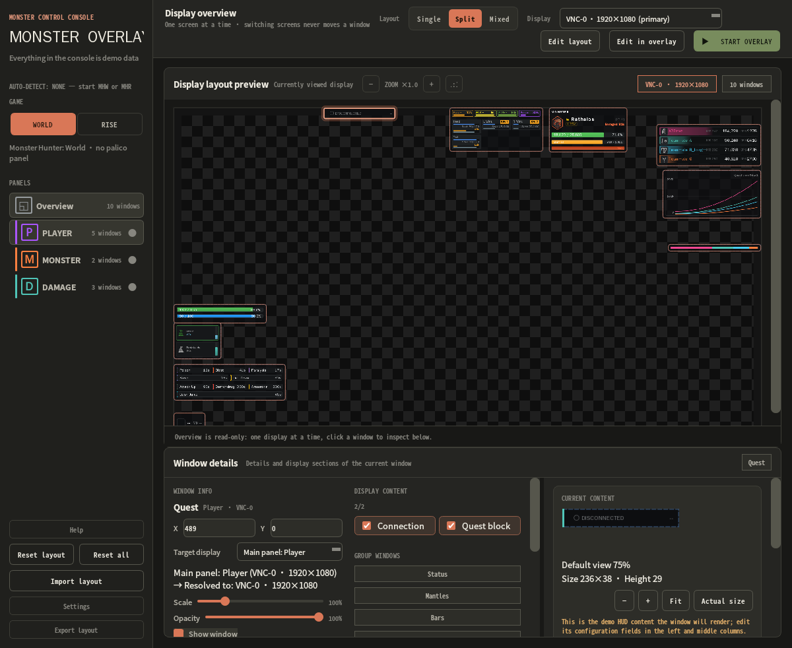

# Monster Overlay

**English** · [简体中文](README.zh-CN.md)

A Wayland HUD overlay for **Monster Hunter: World** and **Monster Hunter Rise**.
It draws player, monster and damage panels over the game by reading the running
process from the outside — no DLL injection, no game files touched.




## Known limitations

- **No Monster Hunter Wilds — yet.** This repo does not carry a Wilds fork
  today: Wilds' current reception has not given us a reason to buy it, and
  without the game in hand there is nothing to adapt. If a future DLC makes
  the game worth picking up, we may revisit this from this code base.

## Requirements

- x86_64 Linux, Wayland session with a layer-shell compositor (KDE Plasma,
  Hyprland, niri, sway, …)
- Qt 6.11 or newer (Widgets, Svg) **including its private QtGui headers** —
  most distributions ship those in a separate `-private-` package, see
  [Qt 6.11 outside Arch](#qt-611-outside-arch) below
- `layer-shell-qt`
- `sudo ./install-deps.sh` installs all of it on Arch, once
- Steam, with **GE-Proton 10-34** recommended (other Proton 9+ builds work)
- No mods and no special permissions. World needs nothing else at all;
  Rise damage tracking additionally uses the bundled REFramework Lua
  producer, which the console installs for you

## Install

```bash
tar -xzf monster-overlay-v0.12.0-linux-x86_64.tar.gz
cd monster-overlay-v0.12.0-linux-x86_64
sudo ./install-deps.sh      # one-time: Qt 6 + layer-shell-qt
./install.sh                # optional: installs to ~/.local/bin + XDG data dir
```

## Run

1. Start the game and get past the main menu.
2. Start the console and press **START**:

```bash
./monster-control           # `monster-control` after install.sh
```

The panels appear over the game. The console is where panels and their sections
are switched on/off, positioned, and assigned to a display.

### Keyboard shortcuts (overlay)

When the console spawns the overlay, it hides itself and the panels become the
focused window. From there:

| Key | Action |
|---|---|
| `Esc` | quit the overlay and return focus to the console |
| `Space` | temporarily collapse the overlay to a small block — press again to restore |
| arrow keys | in edit mode, nudge the focused panel 10 px (`Shift`+arrow keys = 50 px) |

The arrow-key nudge is the layout mode (`./monster-overlay --edit`, also entered
from the console). The full edit-mode cheatsheet — click-to-focus, mouse-wheel
scale, and the fact that every change persists immediately (there is no save
shortcut) — lives in [docs/USAGE.md §4](docs/USAGE.md).

## Panels

| Panel | Shows |
|---|---|
| Player | name, HP / stamina, sharpness, weapon, wirebug (Rise), mantles (World), ailments, food skills |
| Monster | current target, HP and part damage, ailments, enrage / stamina (Rise), crown size |
| Damage | per-player damage and DPS — World reads it directly; Rise needs the bundled REFramework Lua producer (see [docs/USAGE.md](docs/USAGE.md)) |

## Language

The UI follows the desktop locale on first run — `zh*` → Chinese, anything else
→ English. The `中文 | EN` chip in the console switches it instantly (the
overlay follows within a second) and remembers the choice. Saving panel
switches never pins the language.

## If a read is denied

Steam starts the game inside a user namespace owned by you, so the overlay
normally needs no privileges at all. If it ever cannot read the game, the panel
says so with the errno and prints the two remedies:

```bash
sudo setcap cap_sys_ptrace+ep ./monster-overlay   # scoped to the binary
sudo sysctl kernel.yama.ptrace_scope=0            # temporary, system-wide
```

## Nothing shows up? Run `monster-doctor`

```bash
./monster-doctor            # writes monster-doctor-<timestamp>.txt
```

Read-only, no privileges, ~15 s. It records where the address maps were found,
whether a game process is visible and at which image base, the reader's verdict
with the exact errno, which Proton build the game runs under, its launch
options, and the overlay's own status output. Attach the report to a GitHub
issue: paths under `~` print as `~`, and no environment variables, Steam
account data or game memory are collected.

## Build from source

```bash
cmake -S . -B build
cmake --build build -j"$(nproc)"
ctest --test-dir build          # 7 of 17 suites need a running game and skip
./build/monster-overlay         # run from the repo: maps resolve from data/
```

Requires CMake ≥ 3.25, a C++20 compiler, Qt 6.11+ and `layer-shell-qt`.
The build path is only documented and exercised on **Arch Linux**; other
distros need to source the Qt 6 and `LayerShellQt` packages themselves.
Prebuilt tarballs are the supported route elsewhere — see §Install.

### Qt 6.11 outside Arch

Two things to know before you compile on anything other than Arch.

**Qt 6.11 is rare outside rolling distros.** The Ubuntu 24.04 and Debian 13
LTS releases ship Qt 6.4.2 and 6.8.2; Ubuntu 26.04 and Fedora 44 ship 6.10.x.
Only rolling releases (Fedora 43+/Rawhide, openSUSE Tumbleweed) track 6.11.

**The private QtGui headers are a separate package.** `screen_query.cpp`
reads the screen's real pixel size through `QPlatformScreen::geometry()`,
which needs `qpa/qplatformscreen.h` — Qt does not guarantee that API's
stability, so distributions move it out of the main devel package. Install
that package explicitly:

| Distribution | Private QtGui headers | `layer-shell-qt` |
|---|---|---|
| Arch | `qt6-base` (included) | `layer-shell-qt` |
| Debian / Ubuntu | `qt6-base-private-dev` | `layer-shell-qt6` |
| Fedora | `qt6-qtbase-private-devel` | `layer-shell-qt6` |
| openSUSE | `qt6-base-private-devel` | `layer-shell-qt6` |

Two naming traps on the Qt5-era names:

- Ubuntu 24.04's `layer-shell-qt` is the **Qt 5** build (5.27.11, against
  `liblayershellqtinterface5`) — it will not satisfy this project, which
  links `libLayerShellQtInterface.so.6`. On Ubuntu 24.04 the Qt 6 package
  is `layer-shell-qt6`; on Fedora/openSUSE the Qt 6 package is likewise
  `layer-shell-qt6`, while `layer-shell-qt` stays the Qt 5 one.
- The prebuilt binaries additionally link `libQt6Svg.so.6` and carry
  `Qt_6.11` versioned symbols, so running them needs Qt ≥ 6.11 libraries no
  matter which release you are on.

## License

Apache-2.0 — see [LICENSE](LICENSE). Derived from
[HunterPie v2](https://github.com/HunterPie/HunterPie); address maps and adapted
icon data are credited in [assets/NOTICE](assets/NOTICE).

Full usage guide: [docs/USAGE.md](docs/USAGE.md) · 中文版: [docs/USAGE.zh-CN.md](docs/USAGE.zh-CN.md)
