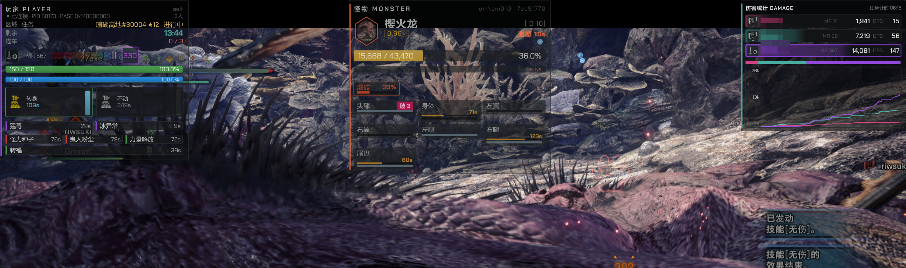
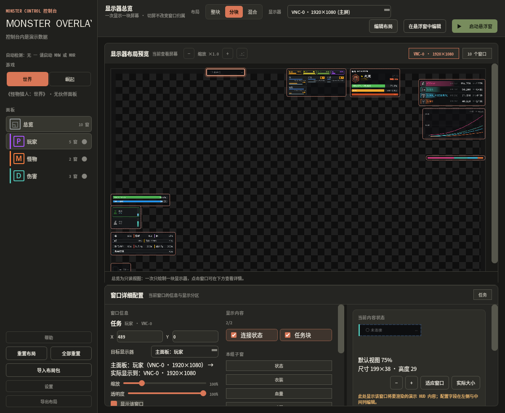

# Monster Overlay

[English](README.md) · **简体中文**

**怪物猎人:世界**与**怪物猎人:崛起**的 Wayland HUD 覆盖层。通过从外部读取
游戏进程的内存,把玩家 / 怪物 / 伤害面板绘制在游戏画面上 —— 不注入 DLL、
不修改游戏文件。




## 已知问题

- **暂不支持《怪物猎人:荒野》。**本仓库当前没有荒野分支 —— 荒野风评
  不好,目前没有让我们想购买的理由,手里没有游戏自然也无法承诺适配。
  如果未来 DLC 让游戏重新变得值得入手,我们可能会从本代码基线重新评估。

## 环境要求

- x86_64 Linux,Wayland 会话 + 支持 layer-shell 的合成器(KDE Plasma、
  Hyprland、niri、sway 等)
- Qt 6.11 或更高(Widgets、Svg),**并且要带上私有 QtGui 头** —— 大多数发行版
  把私有头单独放在一个 `-private-` 包里,见下文[非 Arch 的 Qt 6.11](#非-arch-的-qt-611)
- `layer-shell-qt`
- Arch 上执行一次 `sudo ./install-deps.sh`,以上全部装好
- Steam,推荐 **GE-Proton 10-34**(其他 Proton 9+ 也可)
- 不需要 mod,默认不需要任何特殊权限。世界范畴零额外依赖;崛起的伤害
  统计另需随包发布的 REFramework Lua producer,由控制台代为安装

## 安装

```bash
tar -xzf monster-overlay-v0.12.0-linux-x86_64.tar.gz
cd monster-overlay-v0.12.0-linux-x86_64
sudo ./install-deps.sh      # 一次性:Qt 6 + layer-shell-qt
./install.sh                # 可选:装到 ~/.local/bin 与 XDG 数据目录
```

## 启动

1. 启动游戏,进到主菜单之后。
2. 启动控制台并点 **START**:

```bash
./monster-control           # 跑过 install.sh 后直接 `monster-control`
```

三块面板会浮在游戏之上。面板与其子项的开关、位置、所在屏幕,都在控制台里设置。

### 快捷键(悬浮窗)

控制台启动悬浮窗后会自动隐藏,面板成为焦点窗口。此时:

| 按键 | 作用 |
|---|---|
| `Esc` | 关闭悬浮窗,焦点回到控制台 |
| `Space` | 把悬浮窗暂时折叠成一个小色块 —— 再按一次恢复 |
| 方向键 | 在布局模式中,微调焦点面板 10 px(`Shift` + 方向键 = 50 px) |

方向键微调属于布局模式(控制台可进入,或直接 `./monster-overlay --edit`)。
完整的布局模式速查 —— 点击聚焦、滚轮缩放、以及每次改动都会立即落盘(没有保存快捷键) —— 见
[docs/USAGE.zh-CN.md §4](docs/USAGE.zh-CN.md)。

## 面板内容

| 面板 | 显示 |
|---|---|
| 玩家 | 名称、血量 / 耐力、斩味、武器、翔虫(崛起)、衣装(世界)、异常状态、猫饭技能 |
| 怪物 | 当前目标、血量与部位破坏、异常状态、愤怒 / 体力(崛起)、体型金冠 |
| 伤害 | 每位玩家的伤害与 DPS —— 世界直接读取;崛起需用随包发布的 REFramework Lua producer(见 [docs/USAGE.zh-CN.md](docs/USAGE.zh-CN.md)) |

## 语言

首次运行跟随系统语言 —— `zh*` 用中文,其他一律英文。控制台的 `中文 | EN`
可即时切换(悬浮窗约 1 秒内跟随),并记住你的选择;保存面板开关**不会**改写
语言选择。

## 读取被拒绝时

Steam 会把游戏放进一个由你拥有的 user namespace,所以覆盖层通常**不需要
任何额外权限**。万一读取被拒绝,面板会给出 errno 与两种解法:

```bash
sudo setcap cap_sys_ptrace+ep ./monster-overlay   # 只作用于该二进制
sudo sysctl kernel.yama.ptrace_scope=0            # 临时,系统级
```

## 面板不显示?跑 `monster-doctor`

```bash
./monster-doctor            # 生成 monster-doctor-<时间戳>.txt
```

只读、无需权限、约 15 秒。它会记录:地址表从哪里找到的、游戏进程是否可见及
装载基址、读取判定与确切 errno、游戏实际使用的 Proton 与启动参数、以及覆盖层
自己的状态输出。把这个文件附到 issue 里即可:家目录路径折叠为 `~`,不采集环境
变量、Steam 账号信息与游戏内存内容。

## 从源码构建

```bash
cmake -S . -B build
cmake --build build -j"$(nproc)"
ctest --test-dir build          # 17 个套件中 7 个需要游戏在跑,会跳过
./build/monster-overlay         # 在仓库根目录运行:地图从 data/ 解析
```

需要 CMake ≥ 3.25、C++20 编译器、Qt 6.11+ 与 `layer-shell-qt`。
源码编译路径**仅在 Arch Linux 上验证过**;其他发行版需自行准备
Qt 6 与 `LayerShellQt` 依赖。建议直接用上方预编译包(见「安装」)。

### 非 Arch 的 Qt 6.11

在 Arch 之外编译之前,有两件事要先知道。

**出了滚动发行版,Qt 6.11 基本拿不到。**Ubuntu 24.04 与 Debian 13 分别是
Qt 6.4.2 和 6.8.2;Ubuntu 26.04 与 Fedora 44 是 6.10.x。只有滚动发行版
(Fedora 43+ / Rawhide、openSUSE Tumbleweed)才跟着 6.11 走。

**私有 QtGui 头是一个独立的包。**`screen_query.cpp` 通过
`QPlatformScreen::geometry()` 读取屏幕的真实像素尺寸,需要
`qpa/qplatformscreen.h` —— Qt 不保证这个 API 的稳定性,所以发行版把它从
主 devel 包里单独拆了出来。要显式装这个包:

| 发行版 | 私有 QtGui 头 | `layer-shell-qt` |
|---|---|---|
| Arch | `qt6-base`(已包含) | `layer-shell-qt` |
| Debian / Ubuntu | `qt6-base-private-dev` | `layer-shell-qt6` |
| Fedora | `qt6-qtbase-private-devel` | `layer-shell-qt6` |
| openSUSE | `qt6-base-private-devel` | `layer-shell-qt6` |

两个 Qt5 时代的命名陷阱:

- Ubuntu 24.04 的 `layer-shell-qt` 是 **Qt 5** 版本(5.27.11,依赖
  `liblayershellqtinterface5`),满足不了本项目 —— 本项目链接的是
  `libLayerShellQtInterface.so.6`。Ubuntu 24.04 上 Qt 6 的包叫
  `layer-shell-qt6`;Fedora / openSUSE 的 Qt 6 包同样叫 `layer-shell-qt6`,
  `layer-shell-qt` 留在 Qt 5 那边。
- 预编译包还会额外链接 `libQt6Svg.so.6`,并带 `Qt_6.11` 版本化符号 ——
  所以无论你在哪个发行版上,**运行**预编译包都需要 ≥ 6.11 的 Qt 库。

## 许可

Apache-2.0,见 [LICENSE](LICENSE)。派生自
[HunterPie v2](https://github.com/HunterPie/HunterPie);地址表与改编的图标
数据署名见 [assets/NOTICE](assets/NOTICE)。

完整使用说明:[docs/USAGE.zh-CN.md](docs/USAGE.zh-CN.md)(英文版:[docs/USAGE.md](docs/USAGE.md))。
